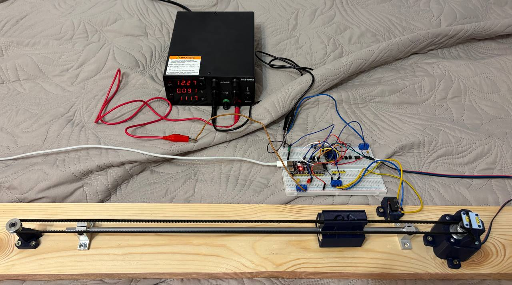
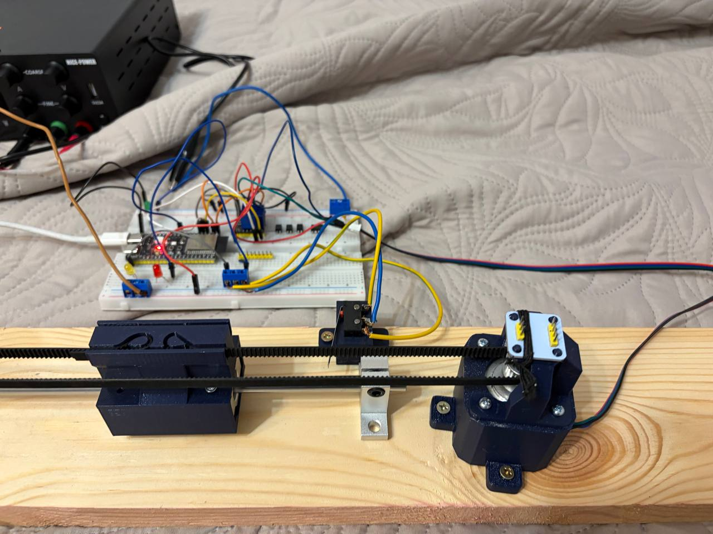
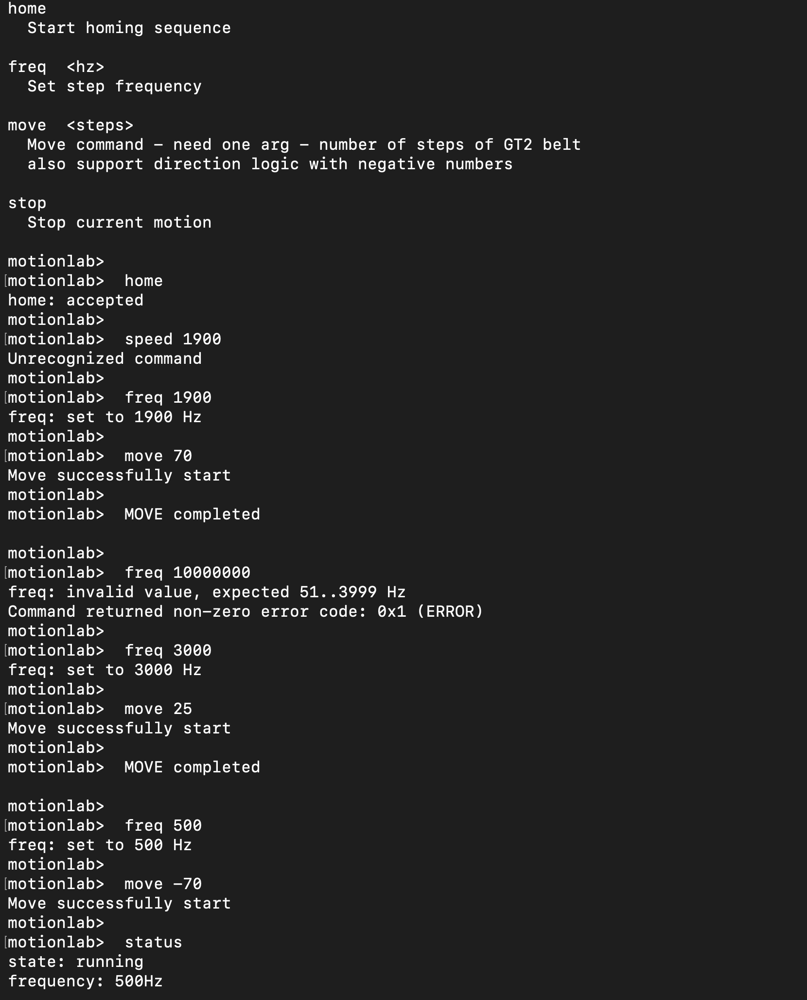
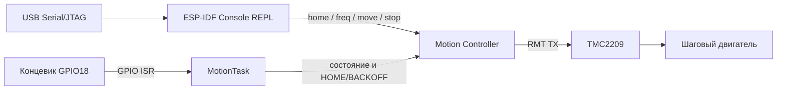

# MotionLab — управление линейной осью на ESP32-S3

## О проекте

MotionLab — учебный embedded-проект для управления линейной осью с шаговым двигателем. Прошивка работает на ESP32-S3 и ESP-IDF: формирует STEP-сигнал через RMT, управляет драйвером TMC2209, обрабатывает концевик и предоставляет USB-консоль для ручного запуска команд.

Цель проекта — на реальном стенде разобрать архитектуру прошивки: разделить ввод команд, управление движением и низкоуровневую работу с периферией ESP32.

## Демонстрация



Линейная ось собрана на ремне GT2. На стенде установлены ESP32-S3, драйвер TMC2209, шаговый двигатель, механический концевик и внешнее питание двигателя.



Консоль доступна через встроенный USB Serial/JTAG ESP32-S3. На скриншоте — запуск homing, изменение частоты, движение в обе стороны, проверка некорректного значения и чтение состояния.



## Фичи

- **RMT TX** формирует последовательность STEP-импульсов без программного переключения GPIO в цикле.
- **FreeRTOS**: отдельная задача `MotionTask` ждёт события окончания передачи и срабатывания концевика.
- **FSM состояния двигателя**: `stopped`, `running`, `homing`, `backoff`, `home`, `limit_hit`, `error`.
- **HOME/BACKOFF**: при поиске нуля ось движется к концевику, затем отъезжает до его отпускания и только после этого получает состояние `home`.
- **USB-консоль ESP-IDF**: `help`, `status`, `home`, `freq <hz>`, `move <steps>`, `stop`.
- **Проверка пользовательского ввода**: консоль отклоняет неверный формат чисел, а motion-слой проверяет диапазон и допустимое текущее состояние.

Текущие ограничения интерфейса:

- `freq` принимает частоту от `51` до `3999` Гц;
- `move` принимает значение от `-200` до `200`, кроме `0`;
- значение `move` — логический шаг MotionLab, а не прямое число импульсов STEP: сейчас один логический шаг преобразуется контроллером в 80 RMT-импульсов;
- encoder AS5600 пока не участвует в рабочем контуре управления.

## Hardware

| Компонент | Назначение |
| --- | --- |
| ESP32-S3 DevKitC | Основной контроллер, USB-консоль и RMT-периферия |
| TMC2209 | Драйвер шагового двигателя в режиме STEP/DIR |
| Шаговый двигатель и ремень GT2 | Привод линейной оси |
| Механический концевик | Поиск нулевой позиции и ограничение движения |
| Внешний источник питания | Питание двигателя и драйвера |

### GPIO

| GPIO ESP32-S3 | Сигнал | Направление | Назначение |
| ---: | --- | --- | --- |
| GPIO4 | `DIR` | output | Направление вращения TMC2209 |
| GPIO5 | `STEP` | output / RMT TX | Шаговые импульсы TMC2209 |
| GPIO6 | `EN` | output | Разрешение драйвера |
| GPIO18 | `LIMIT` | input + ISR | Механический концевик |

USB Serial/JTAG использует встроенный USB-контроллер ESP32-S3

## Архитектура



`src/console.c` отвечает только за интерфейс: разбирает строку команды, валидирует её формат, вызывает публичный motion API и печатает результат.

`src/motion_controller.c` владеет состоянием двигателя и RMT. Он создаёт профиль движения, выбирает направление, отправляет импульсы, принимает события `TX_DONE` и концевика. Решение о допустимости движения остаётся здесь, а не в консоли.

Структура исходников:

```text
src/
├── main.c                 # запуск контроллера и USB-консоли
├── console.c/.h           # команды REPL
├── motion_controller.c    # RMT, GPIO, FSM и MotionTask
├── montion_controller.h   # публичный motion API
└── as5600_encoder.c/.h    # экспериментальный код энкодера, пока не подключён к контуру
```

## Сборка и запуск

Нужны PlatformIO Core и подключённая ESP32-S3. Конфигурация проекта рассчитана на ESP-IDF и 16 МБ flash на используемой плате.

```bash
pio run
pio run -t upload
pio device monitor --baud 115200
```

После загрузки должна появиться консоль. Базовый ручной сценарий:

```text
motionlab> help
motionlab> status
motionlab> home
motionlab> freq 700
motionlab> move 50
motionlab> status
```

`home` и `move` запускают асинхронное движение: ответ `accepted` означает, что команда принята контроллером, а не что каретка уже приехала в целевую точку. Текущее состояние проверяется командой `status`.
